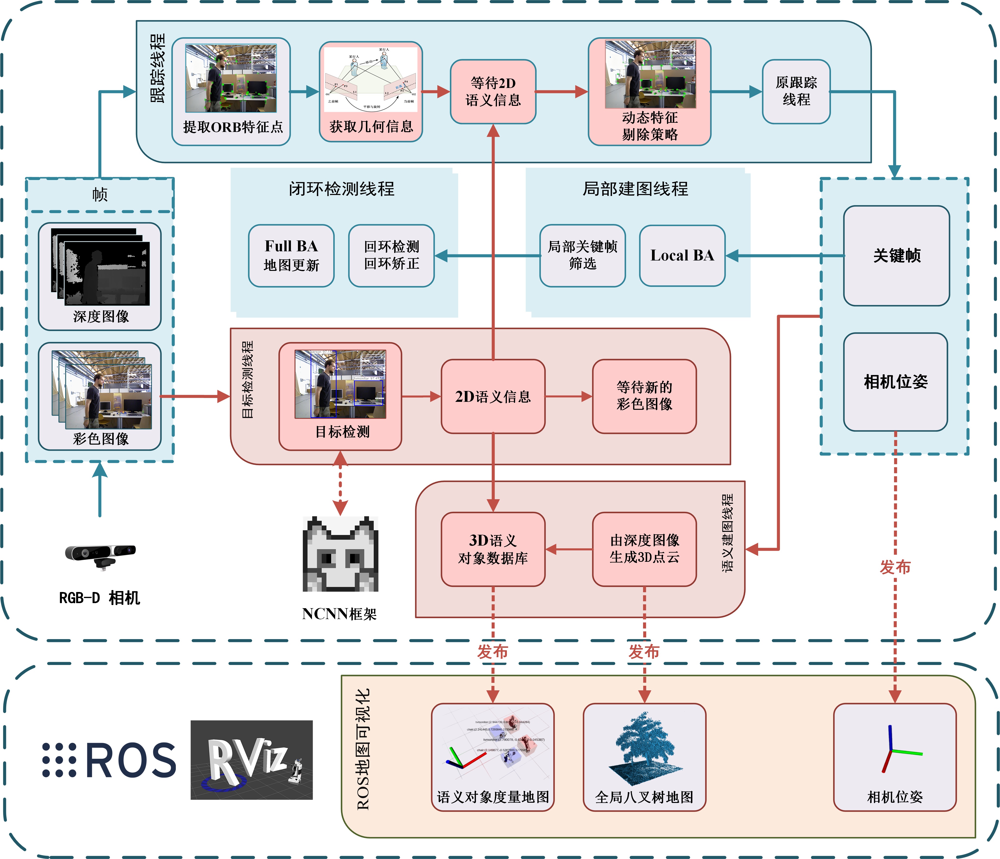
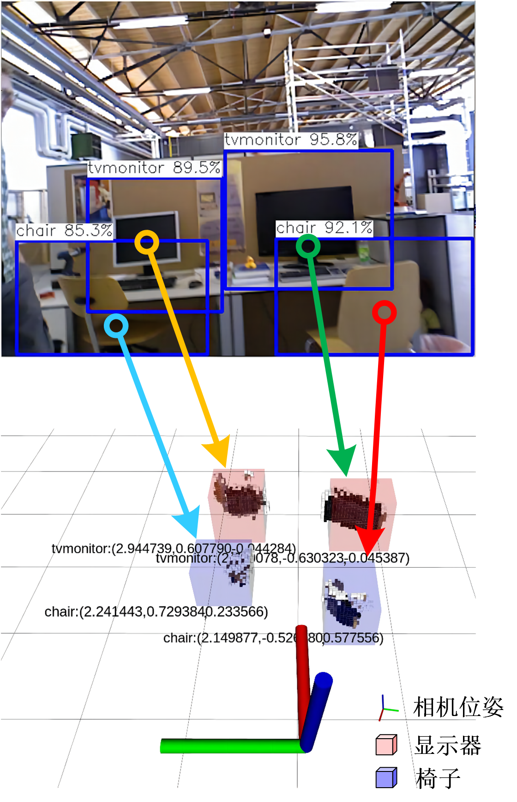

<div align="center">

# SG-SLAM

### 面向动态场景的实时 RGB-D 语义视觉 SLAM 系统

融合语义与几何信息的动态特征剔除 · 语义对象度量地图

[](./LICENSE)
[](https://ieeexplore.ieee.org/abstract/document/9978699/)
[](https://github.com/raulmur/ORB_SLAM2)
[](http://wiki.ros.org/melodic)

[English](./README.md) · **简体中文**

[](https://www.bilibili.com/video/BV1nm4y1y7Ar)
[](https://youtu.be/16w_4NRFCdY)
[](https://kns.cnki.net/kcms2/article/abstract?v=A4c134OkBY89HY-IQP8ZRIpp_9SfQuIfsYpw_9qtvftq7ChBZP5PKLT4XlHfRZr07gDt1eH0cyferPskgmLonqA6u0CDYOzRF-pZUcNd006SERL0NUyPyZFnPbG5y9NJ&uniplatform=NZKPT&flag=copy)
[](./doc/master's%20thesis.pdf)

📖 遇到问题？先看 **[常见问题解答 FAQ](./FAQ-zh.md)**（整理自全部 GitHub Issues）

</div>

---

## ✨ 项目简介

SLAM 是智能移动机器人在未知环境中进行状态估计的基本能力之一。然而现实中存在两个普遍痛点：

> 🚶 **动态干扰** — 大多数视觉 SLAM 依赖*静态场景假设*，在动态场景中精度与鲁棒性严重下降。
>
> 🧩 **缺乏语义** — 许多系统构建的度量地图*没有语义信息*，机器人无法在人类认知层面理解周围环境。

**SG-SLAM** 是一个基于 [ORB-SLAM2](https://github.com/raulmur/ORB_SLAM2) 的实时 RGB-D 语义视觉 SLAM 系统，针对上述问题做了三点改进：

- 🧵 **新增两个并行线程** — 获取 2D 语义信息的**目标检测线程**，以及生成三维地图的**语义建图线程**。
- ⚡ **快速动态特征剔除** — 在跟踪线程中融合*语义 + 几何*信息，快速剔除动态特征点。
- 🗺️ **语义地图可视化** — 生成 3D 点云与 3D 语义对象后发布到 ROS，可在 RViz 中实时查看。

在 **TUM**、**Bonn** 与 **OpenLORIS-Scene** 数据集上的实验表明，SG-SLAM 不仅是动态场景中实时、准确、鲁棒的系统之一，还能创建直观的语义对象度量地图。

### 🎯 系统特点

| | |
|---|---|
| 🧱 **成熟基座** | 基于 ORB-SLAM2、NCNN、ROS 等 |
| ⏱️ **实时运行** | 配好 NCNN 的 GPU / CUDA 加速即可实时 |
| 🔧 **易于部署** | 相比同类工作更容易配置和部署 |

---

## 🖼️ 效果展示

<div align="center">



**图 1 · 系统框架** — ORB-SLAM2 原始框架以水绿色背景呈现，新增（或修改）功能以红色背景呈现。

<br>

<table>
  <tr>
    <td align="center" width="33%">
      <br>
      <b>图 2 · 语义对象度量地图</b><br>
      <sub><code>fr3/walking_xyz</code></sub>
    </td>
    <td align="center" width="33%">
      <br>
      <b>图 3 · 八叉树地图</b><br>
      <sub><code>fr3/long_office_household</code></sub>
    </td>
    <td align="center" width="33%">
      <br>
      <b>图 4 · 实际运行效果</b><br>
      <sub>硬件实测</sub>
    </td>
  </tr>
</table>

</div>

---

## 📄 License 与引用

SG-SLAM 基于 [GPLv3 协议](https://github.com/silencht/SG-SLAM/blob/main/LICENSE) 发布。

论文可在 [IEEE Xplore](https://ieeexplore.ieee.org/abstract/document/9978699/) 下载（或见本仓库 `doc` 目录）。若用于学术研究，请引用：

```bibtex
@ARTICLE{9978699,
  author={Cheng, Shuhong and Sun, Changhe and Zhang, Shijun and Zhang, Dianfan},
  journal={IEEE Transactions on Instrumentation and Measurement},
  title={SG-SLAM: A Real-Time RGB-D Visual SLAM Toward Dynamic Scenes With Semantic and Geometric Information},
  year={2023},
  volume={72},
  number={},
  pages={1-12},
  doi={10.1109/TIM.2022.3228006}}
```

---

## 🛠️ 编译配置

> 💡 以下步骤基于 **Ubuntu 18.04 + ROS Melodic**。展开每个折叠块查看对应命令。

<details open>
<summary><b>① 基础工具</b></summary>

```bash
sudo apt-get update
sudo apt install git cmake build-essential vim

# 验证安装
git --version && gcc --version && g++ --version && cmake --version
```

</details>

<details>
<summary><b>② Pangolin</b></summary>

```bash
sudo apt install libglew-dev libpython2.7-dev
sudo apt install libboost-dev libboost-thread-dev libboost-filesystem-dev

git clone https://github.com/stevenlovegrove/Pangolin.git
cd Pangolin/
git checkout v0.5
mkdir build && cd build
cmake ..
make -j4
sudo make install
```

</details>

<details>
<summary><b>③ OpenCV 3.4.15</b></summary>

> 可参考[官方安装教程](https://docs.opencv.org/3.4.15/d7/d9f/tutorial_linux_install.html)

```bash
sudo apt install libgtk2.0-dev pkg-config libavcodec-dev libavformat-dev libswscale-dev
sudo apt install python-dev python-numpy libtbb2 libtbb-dev libjpeg-dev libpng-dev libtiff-dev libjasper-dev libdc1394-22-dev

git clone https://github.com/opencv/opencv.git
cd opencv/
git checkout 3.4.15
mkdir build && cd build
cmake -D CMAKE_BUILD_TYPE=Release -D CMAKE_INSTALL_PREFIX=/usr/local ..
sudo make install

# 验证安装
pkg-config opencv --modversion
```

</details>

<details>
<summary><b>④ Eigen 3.1.0</b></summary>

```bash
git clone https://gitlab.com/libeigen/eigen.git
cd eigen/
git checkout 3.1.0
mkdir build && cd build
cmake ..
sudo make install

# 验证安装
cat /usr/local/include/eigen3/Eigen/src/Core/util/Macros.h
```

</details>

<details>
<summary><b>⑤ ROS Melodic</b></summary>

```bash
# 中国大陆可换源，参考 http://wiki.ros.org/ROS/Installation/UbuntuMirrors
sudo sh -c '. /etc/lsb-release && echo "deb http://mirrors.tuna.tsinghua.edu.cn/ros/ubuntu/ `lsb_release -cs` main" > /etc/apt/sources.list.d/ros-latest.list'

# 设置密钥
sudo apt-key adv --keyserver 'hkp://keyserver.ubuntu.com:80' --recv-key C1CF6E31E6BADE8868B172B4F42ED6FBAB17C654
sudo apt update

# 安装 ROS（适用于 Ubuntu 18.04）
sudo apt install ros-melodic-desktop-full

# 环境变量配置
echo "source /opt/ros/melodic/setup.bash" >> ~/.bashrc
source ~/.bashrc

# 依赖安装
sudo apt install python-rosinstall python-rosinstall-generator python-wstool build-essential

# 初始化 rosdep（遇到错误可参考 https://zhuanlan.zhihu.com/p/397966333）
sudo apt install python-rosdep
sudo rosdep init
rosdep update

# 验证安装
roscore
```

</details>

<details>
<summary><b>⑥ PCL 与 Octomap</b></summary>

```bash
# PCL 及 pcl-tools（可选）
sudo apt install libpcl-dev pcl-tools

# Octomap 及 octovis（可选）
sudo apt install liboctomap-dev octovis
sudo apt install ros-melodic-octomap ros-melodic-octomap-mapping ros-melodic-octomap-msgs ros-melodic-octomap-ros ros-melodic-octomap-rviz-plugins
```

</details>

<details open>
<summary><b>⑦ 编译 SG-SLAM</b></summary>

```bash
git clone https://github.com/silencht/SG-SLAM

# 编译第三方库：DBoW2、g2o、ncnn
cd SG-SLAM/src/sg-slam/
./ThirdpartyBuild.sh
```

> 📌 **关于 ncnn** — 完整编译安装请参考 [ncnn 官方 README](https://github.com/Tencent/ncnn)。
> 安装好英伟达显卡驱动、Vulkan 等后，编译并安装 ncnn；若出现编译错误，尝试 `-DNCNN_DISABLE_RTTI=OFF`（见 [issue #2665](https://github.com/Tencent/ncnn/issues/2665)）。

```bash
cd SG-SLAM/src/sg-slam/Thirdparty/ncnn/
mkdir build && cd build
cmake -DCMAKE_TOOLCHAIN_FILE=../toolchains/host.gcc.toolchain.cmake -DNCNN_DISABLE_RTTI=OFF ..
make -j4          # -j 后的数字可按 CPU 线程数调大以加速编译
sudo make install
```

> ⚠️ 修改 `SG-SLAM/src/sg-slam/CMakeLists.txt` 中的 ncnn 路径为你自己系统中的路径（该路径下需包含 `ncnnConfig.cmake`）：
> ```cmake
> set(ncnn_DIR "替换为你的路径/SG-SLAM/src/sg-slam/Thirdparty/ncnn/build/install/lib/cmake/ncnn" CACHE PATH "Directory that contains ncnnConfig.cmake")
> ```

初始化 ROS 工作空间，然后依次编译各功能包：

| 功能包 | 作用 |
|---|---|
| `cv_bridge` | 将相机输出的 ROS 与 OpenCV 话题消息格式互转 |
| `image_geometry` | 提供一系列图像几何处理方法 |
| `octomap_server` | 接收 SG-SLAM 发布的 3D 点云并转化为八叉树地图 |
| `sg-slam` | SG-SLAM 系统主代码 |

```bash
cd SG-SLAM/src
catkin_init_workspace
cd ..
catkin_make --pkg cv_bridge
catkin_make --pkg image_geometry
catkin_make --pkg octomap_server
catkin_make --pkg sg-slam
```

</details>

---

## 🚀 运行 SG-SLAM

下载 [TUM 数据集](https://vision.in.tum.de/data/datasets/rgbd-dataset/download) 后放入 home 目录下的 `Music` 路径（该路径与 `run_tum_walking_xyz.sh` 一致，也可自行修改）。

依次打开 **4 个终端**：

```bash
# 终端 1 —— 启动 ROS 核心
roscore
```

```bash
# 终端 2 —— 启动八叉树建图节点（建图参数可在 launch 文件中配置）
cd your_sg-slam_path/src/octomap_server/launch
roslaunch octomap.launch
```

```bash
# 终端 3 —— 打开 RViz（使用预置配置可自动订阅地图话题）
rviz -d your_sg-slam_path/src/sg-slam/Examples/rvizconfig.rviz
```

```bash
# 终端 4 —— 运行 TUM 数据集 walking_xyz 序列
# （也可运行硬件相机，如 run_astra_pro_camera.sh）
cd your_sg-slam_path/src/sg-slam/
./run_tum_walking_xyz.sh
```

---

## 🙏 参考仓库

> 包括但不限于以下仓库（排列顺序无意义）：

<details>
<summary><b>展开查看完整列表</b></summary>

- [ORB_SLAM2](https://github.com/raulmur/ORB_SLAM2)
- [DS-SLAM](https://github.com/ivipsourcecode/DS-SLAM)
- [ORB_SLAM2_SSD_Semantic](https://github.com/Ewenwan/ORB_SLAM2_SSD_Semantic)
- [semantic_slam_nav_ros](https://github.com/MRwangmaomao/semantic_slam_nav_ros)
- [ORBSLAM2_with_pointcloud_map](https://github.com/gaoxiang12/ORBSLAM2_with_pointcloud_map)
- [ORB_SLAM2 (abhineet123)](https://github.com/abhineet123/ORB_SLAM2)
- [semantic_slam](https://github.com/floatlazer/semantic_slam)
- [YOLO-DynaSLAM](https://github.com/bijustin/YOLO-DynaSLAM)
- [Fast-Dynamic-ORB-SLAM](https://github.com/bijustin/Fast-Dynamic-ORB-SLAM)
- [VDO_SLAM](https://github.com/halajun/VDO_SLAM)
- [IndoorMapping](https://github.com/Quitino/IndoorMapping)
- [orb_slam2_ros_dense_map](https://github.com/ninedayhx/orb_slam2_ros_dense_map)
- [ORB_SLAM3_ROS](https://github.com/lturing/ORB_SLAM3_ROS)
- [ORB-SLAM2_DENSE](https://github.com/IATBOMSW/ORB-SLAM2_DENSE)
- [ORB-SLAM2_RGBD_DENSE_MAP](https://github.com/xiaobainixi/ORB-SLAM2_RGBD_DENSE_MAP)
- [3D-Object-Detection-with-Point-Clouds](https://github.com/laavanyebahl/3D-Object-Detection-with-Point-Clouds)

</details>

---

## 📚 进阶说明

### 5.1 · octomap_server 节点

配置文件：`SG-SLAM/src/octomap_server/launch/octomap.launch`

该文件用于启动 octomap_server 节点并配置参数，各参数含义可参考 [ROS Wiki](http://wiki.ros.org/octomap_server) 与 [Octomap 官网](https://octomap.github.io/)。

| 参数 | 说明 |
|---|---|
| `resolution` | octomap 的体素分辨率。越小地图越精细、分辨率越高，但处理时间与计算量也随之增加。 |
| `occupancy_min_z` / `occupancy_max_z` | 按 z 轴范围过滤点云。若相机初始视图与地面平行，可用它过滤掉地面或房顶体素（小技巧）。 |
| `filter_ground` | 过滤地面的正规算法（区别于用 `occupancy_min_z` 直接过滤的技巧），用法见上方网址，当前默认关闭。 |

<details>
<summary><b>查看 octomap.launch 示例</b></summary>

```xml
<!--
  Example launch file for octomap_server mapping:
-->
<launch>
	<node pkg="octomap_server" type="octomap_server_node" name="octomap_server">
		<remap from="cloud_in" to="/SG_SLAM/Point_Clouds" />
		<param name="frame_id" type="string" value="/map" />
		<param name="resolution" value="0.05" />
        <param name="sensor_model/hit" value="0.7" />
        <param name="sensor_model/miss" value="0.4" />
		<param name="sensor_model/max" value="0.99" />
		<param name="sensor_model/min" value="0.12" />
		<param name="sensor_model/max_range" value="-1.0" />
		<param name="height_map" type="bool" value="false" />
		<param name="colored_map" type="bool" value="true" />
		<param name="latch" type="bool" value="false" />
		<param name="occupancy_min_z" type="double" value="-1.5" />
		<param name="occupancy_max_z" type="double" value="1.5" />

		<param name="filter_ground" type="bool" value="false" />
		<param name="base_frame_id" type="string" value="/map" />

		<param name="filter_speckles" type="bool" value="true" />
		<param name="ground_filter/distance" type="double" value="0.05" />
		<param name="ground_filter/angle" type="double" value="0.15" />
		<param name="ground_filter/plane_distance" type="double" value="0.05" />
		<param name="pointcloud_min_z" type="double" value="-5.0" />
		<param name="pointcloud_max_z" type="double" value="5.0" />
	</node>
</launch>
```

</details>

### 5.2 · 相机参数 yaml 文件

配置文件：`SG-SLAM/src/sg-slam/Examples/astra_pro_camera.yaml`、`TUM1.yaml` ……

相机配置文件新增了以下参数项：

```yaml
PointCloudMapping.is_map_construction_consider_dynamic: 0

PointCloudMapping.camera_valid_depth_Min: 0.5
PointCloudMapping.camera_valid_depth_Max: 5.0

PointCloudMapping.is_octo_semantic_map_construction: 0
PointCloudMapping.Sor_Local_MeanK: 50
PointCloudMapping.Sor_Local_StddevMulThresh: 2.0
PointCloudMapping.Voxel_Local_LeafSize: 0.01

PointCloudMapping.is_global_pc_reconstruction: 1
PointCloudMapping.Sor_Global_MeanK: 50
PointCloudMapping.Sor_Global_StddevMulThresh: 2.0
PointCloudMapping.Voxel_Global_LeafSize: 0.01

Detector3D.Sor_MeanK: 50
Detector3D.Sor_StddevMulThresh: 1.0
Detector3D.Voxel_LeafSize: 0.01
Detector3D.EuclideanClusterTolerance: 0.02
Detector3D.EuclideanClusterMinSize: 1000
Detector3D.EuclideanClusterMaxSize: 30000
Detector3D.DetectSimilarCompareRatio: 0.1
Detector3D.global_pc_update_kf_threshold: 30

Detector2D.detection_confidence_threshold: 0.985
Detector2D.dynamic_detection_confidence_threshold: 0.1
```

<details>
<summary><b>点击展开各参数详细说明</b></summary>

**`PointCloudMapping.is_map_construction_consider_dynamic`**
构建 octomap 或三维点云地图时，动态对象会影响建图质量。设为 `1` 时会尽可能剔除动态对象（代码实现为剔除行人），即不对动态对象建图；若场景中不存在动态类别，可设为 `0`。

**`PointCloudMapping.camera_valid_depth_Min` / `camera_valid_depth_Max`**
RGB-D 相机受硬件与原理限制，深度图存在有效观测范围。这两个参数用于限制深度图的有效数值范围，可按相机型号调节，默认 0.5 米 ~ 5 米。

**`PointCloudMapping.is_octo_semantic_map_construction`**
是否构建 octomap 与语义对象度量地图。`1` 构建，`0` 不构建。

**`PointCloudMapping.Sor_Local_MeanK` / `Sor_Local_StddevMulThresh` / `Voxel_Local_LeafSize`**
当 `is_octo_semantic_map_construction = 1` 时生效，用于对单帧深度图转换得到的三维点云进行滤波。
以 `Voxel_Local_LeafSize` 为例，它最终传递给 `PointCloudMapping` 类的 Voxel 滤波器，作为深度图转 3D 点云后体素过滤的分辨率。由于深度图直接转换出的点云数量极大（640×480），计算负担重，需要过滤；voxel filter 用体素内所有点的重心近似其他点，从而减少计算量。经测试在作者设备上一般设为 `0.01`，计算效率与效果达到很好的平衡，可按硬件调整。

**`PointCloudMapping.is_global_pc_reconstruction`**
是否进行三维点云地图重建。`1` 进行，`0` 不进行。由于建图计算成本不小，一般建议此参数与 `is_octo_semantic_map_construction` 不要同时开启。

**`PointCloudMapping.Sor_Global_MeanK` / `Sor_Global_StddevMulThresh` / `Voxel_Global_LeafSize`**
作用类似上面的 `Sor_Local_*` 参数。

**`Detector3D.Sor_MeanK` / `Sor_StddevMulThresh` / `Voxel_LeafSize`**
作用类似 `Sor_Local_*`。用于获取 3D 语义对象时，对检测框内的点云团进行滤波。下面的欧式聚类参数同样是为了尽可能准确地提取目标对象点云团。

**`Detector3D.EuclideanClusterTolerance` / `EuclideanClusterMinSize` / `EuclideanClusterMaxSize`**
对检测框内点云进行欧式聚类分割的参数，用于尽可能准确地从检测框点云团中分割出目标对象点云团。

**`Detector3D.DetectSimilarCompareRatio`**
求点云团与目标对象相似匹配度时的筛选比例参数，作用类似 ORB-SLAM2 中 Bow 词袋匹配的 `mfNNratio`。值越小筛选越严格。

**`Detector3D.global_pc_update_kf_threshold`**
实时进行全局三维点云滤波与发布非常消耗算力，因此平时只处理每帧点云并加入全局地图。仅在系统空闲（缓冲队列无新关键帧）或已处理关键帧数超过该阈值时，才进行全局点云滤波与发布。

**`Detector2D.detection_confidence_threshold`**
普通对象检测的置信度阈值，仅高于该阈值才认为结果可信。过低可能导致地图检测到错误目标，过高则可能漏掉不易辨别的目标，需根据环境与检测模型设置。

**`Detector2D.dynamic_detection_confidence_threshold`**
动态对象检测的置信度阈值。之所以设置较低，是因为动态对象对系统跟踪与建图的负面影响较大，因此需尽可能相信动态对象的检测结果。

</details>

### 5.3 · 动态特征剔除算法

代码位于 `Frame.cc`，核心为第 155 行左右的 **`RmDynamicPointWithSemanticAndGeometry`** 函数。

### 5.4 · octomap_server 部分地图「消失」问题

上个版本 octomap 建图时部分八叉树地图「消失」的问题已解决（重写了点云与 tf 等信息的话题发布代码）。具体问题描述可参考：

- [ROS Answers · decreasing probabilities](https://answers.ros.org/question/224488/octomap-decreasing-probabilities-when-obstacle-is-not-there-anymore/)
- [ROS Answers · globally referenced pointcloud and transform](https://answers.ros.org/question/51837/octomap_server-globally-referenced-pointcloud-and-transform/)
- [知乎 · 问题分析](https://zhuanlan.zhihu.com/p/625190273)
