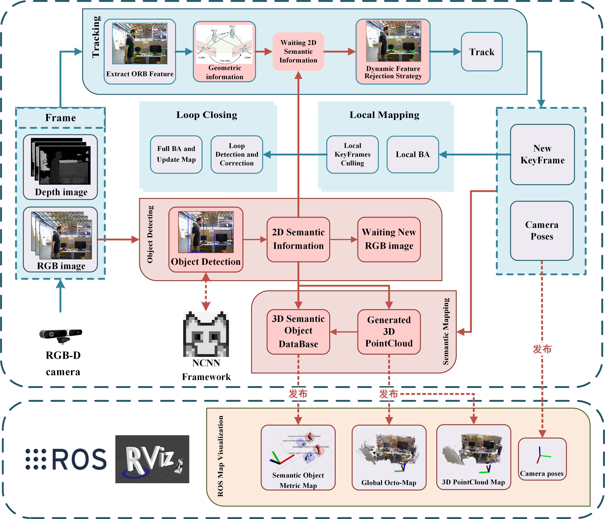
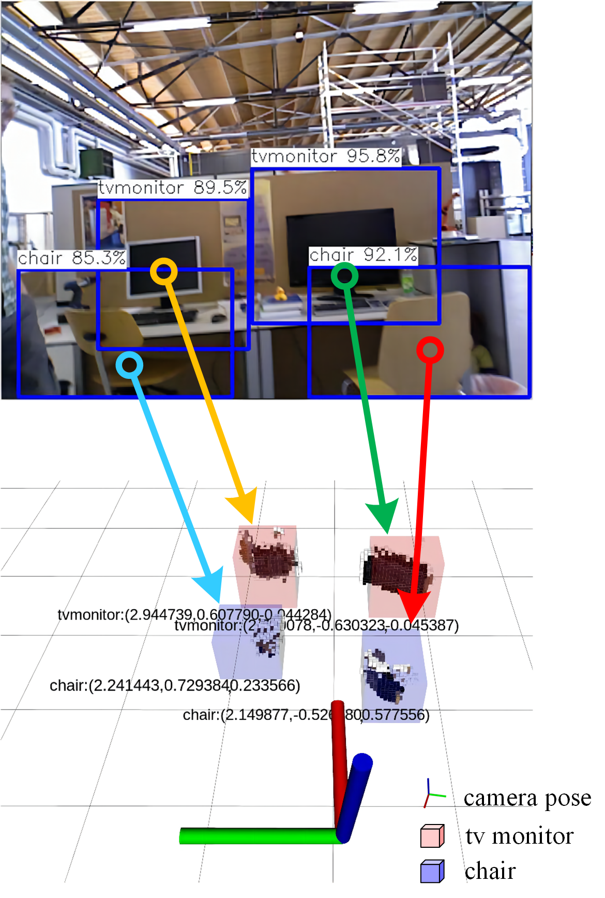

<div align="center">

# SG-SLAM

### A Real-Time RGB-D Visual SLAM Toward Dynamic Scenes With Semantic and Geometric Information

Fast dynamic feature rejection combining semantic and geometric information · Semantic object metric map

[](./LICENSE)
[](https://ieeexplore.ieee.org/abstract/document/9978699/)
[](https://github.com/raulmur/ORB_SLAM2)
[](http://wiki.ros.org/melodic)

**English** · [简体中文](./README-zh.md)

[](https://www.bilibili.com/video/BV1nm4y1y7Ar)
[](https://youtu.be/16w_4NRFCdY)
[](https://kns.cnki.net/kcms2/article/abstract?v=A4c134OkBY89HY-IQP8ZRIpp_9SfQuIfsYpw_9qtvftq7ChBZP5PKLT4XlHfRZr07gDt1eH0cyferPskgmLonqA6u0CDYOzRF-pZUcNd006SERL0NUyPyZFnPbG5y9NJ&uniplatform=NZKPT&flag=copy)
[](./doc/master's%20thesis.pdf)

📖 Hit a problem? Check the **[FAQ](./FAQ.md)** first (compiled from all GitHub Issues)

</div>

---

## ✨ Overview

Simultaneous Localization and Mapping (SLAM) is one of the fundamental capabilities for intelligent mobile robots to perform state estimation in unknown environments. However, two problems are common in practice:

> 🚶 **Dynamic interference** — Most visual SLAM systems rely on the *static scene assumption*, and consequently suffer from severely reduced accuracy and robustness in dynamic scenes.
>
> 🧩 **Lack of semantics** — The metric maps constructed by many systems *lack semantic information*, so robots cannot understand their surroundings at a human cognitive level.

**SG-SLAM** is a real-time RGB-D semantic visual SLAM system based on the [ORB-SLAM2](https://github.com/raulmur/ORB_SLAM2) framework, addressing the problems above with three improvements:

- 🧵 **Two new parallel threads** — an **object detecting thread** to obtain 2D semantic information, and a **semantic mapping thread** to generate 3D maps.
- ⚡ **Fast dynamic feature rejection** — a fast rejection algorithm combining *semantic and geometric information* is added to the tracking thread.
- 🗺️ **Semantic map visualization** — 3D point clouds and 3D semantic objects are published to ROS and can be viewed in RViz in real time.

Experiments on the **TUM**, **Bonn**, and **OpenLORIS-Scene** datasets show that SG-SLAM is not only one of the most real-time, accurate, and robust systems in dynamic scenes, but also allows the creation of intuitive semantic object metric maps.

### 🎯 System Features

| | |
|---|---|
| 🧱 **Solid foundation** | Based on ORB-SLAM2, NCNN, ROS, etc. |
| ⏱️ **Real-time** | Runs in real time when NCNN GPU / CUDA acceleration is configured |
| 🔧 **Easy to deploy** | Easier to configure and deploy than similar works |

---

## 🖼️ Results

<div align="center">



**Fig. 1 · System framework** — The original work of ORB-SLAM2 is presented on an aqua-green background, while the new (or modified) work is presented on a red background.

<br>

<table>
  <tr>
    <td align="center" width="33%">
      <br>
      <b>Fig. 2 · Semantic object metric map</b><br>
      <sub><code>fr3/walking_xyz</code></sub>
    </td>
    <td align="center" width="33%">
      <br>
      <b>Fig. 3 · Octo map</b><br>
      <sub><code>fr3/long_office_household</code></sub>
    </td>
    <td align="center" width="33%">
      <br>
      <b>Fig. 4 · Actual effect</b><br>
      <sub>Real hardware</sub>
    </td>
  </tr>
</table>

</div>

---

## 📄 License & Citation

SG-SLAM is released under a [GPLv3 license](https://github.com/silencht/SG-SLAM/blob/main/LICENSE).

The paper is available on [IEEE Xplore](https://ieeexplore.ieee.org/abstract/document/9978699/) (or in the `doc` directory of this repository). If you use SG-SLAM in academic work, please cite:

```bibtex
@ARTICLE{9978699,
  author={Cheng, Shuhong and Sun, Changhe and Zhang, Shijun and Zhang, Dianfan},
  journal={IEEE Transactions on Instrumentation and Measurement},
  title={SG-SLAM: A Real-Time RGB-D Visual SLAM Toward Dynamic Scenes With Semantic and Geometric Information},
  year={2023},
  volume={72},
  number={},
  pages={1-12},
  doi={10.1109/TIM.2022.3228006}}
```

---

## 🛠️ Building SG-SLAM

> 💡 The steps below are based on **Ubuntu 18.04 + ROS Melodic**. Expand each section for the corresponding commands.

<details open>
<summary><b>① Basic tools</b></summary>

```bash
sudo apt-get update
sudo apt install git cmake build-essential vim

# Test
git --version && gcc --version && g++ --version && cmake --version
```

</details>

<details>
<summary><b>② Pangolin</b></summary>

```bash
sudo apt install libglew-dev libpython2.7-dev
sudo apt install libboost-dev libboost-thread-dev libboost-filesystem-dev

git clone https://github.com/stevenlovegrove/Pangolin.git
cd Pangolin/
git checkout v0.5
mkdir build && cd build
cmake ..
make -j4
sudo make install
```

</details>

<details>
<summary><b>③ OpenCV 3.4.15</b></summary>

> See the [official installation tutorial](https://docs.opencv.org/3.4.15/d7/d9f/tutorial_linux_install.html)

```bash
sudo apt install libgtk2.0-dev pkg-config libavcodec-dev libavformat-dev libswscale-dev
sudo apt install python-dev python-numpy libtbb2 libtbb-dev libjpeg-dev libpng-dev libtiff-dev libjasper-dev libdc1394-22-dev

git clone https://github.com/opencv/opencv.git
cd opencv/
git checkout 3.4.15
mkdir build && cd build
cmake -D CMAKE_BUILD_TYPE=Release -D CMAKE_INSTALL_PREFIX=/usr/local ..
sudo make install

# Test
pkg-config opencv --modversion
```

</details>

<details>
<summary><b>④ Eigen 3.1.0</b></summary>

```bash
git clone https://gitlab.com/libeigen/eigen.git
cd eigen/
git checkout 3.1.0
mkdir build && cd build
cmake ..
sudo make install

# Test
cat /usr/local/include/eigen3/Eigen/src/Core/util/Macros.h
```

</details>

<details>
<summary><b>⑤ ROS Melodic</b></summary>

```bash
# Mirrors for mainland China, see http://wiki.ros.org/ROS/Installation/UbuntuMirrors
sudo sh -c '. /etc/lsb-release && echo "deb http://mirrors.tuna.tsinghua.edu.cn/ros/ubuntu/ `lsb_release -cs` main" > /etc/apt/sources.list.d/ros-latest.list'

# Set up keys
sudo apt-key adv --keyserver 'hkp://keyserver.ubuntu.com:80' --recv-key C1CF6E31E6BADE8868B172B4F42ED6FBAB17C654
sudo apt update

# Install ROS (for Ubuntu 18.04)
sudo apt install ros-melodic-desktop-full

# Environment setup
echo "source /opt/ros/melodic/setup.bash" >> ~/.bashrc
source ~/.bashrc

# Dependencies
sudo apt install python-rosinstall python-rosinstall-generator python-wstool build-essential

# Initialize rosdep (for errors, see https://zhuanlan.zhihu.com/p/397966333)
sudo apt install python-rosdep
sudo rosdep init
rosdep update

# Test
roscore
```

</details>

<details>
<summary><b>⑥ PCL & Octomap</b></summary>

```bash
# PCL and pcl-tools (optional)
sudo apt install libpcl-dev pcl-tools

# Octomap and octovis (optional)
sudo apt install liboctomap-dev octovis
sudo apt install ros-melodic-octomap ros-melodic-octomap-mapping ros-melodic-octomap-msgs ros-melodic-octomap-ros ros-melodic-octomap-rviz-plugins
```

</details>

<details open>
<summary><b>⑦ Build SG-SLAM</b></summary>

```bash
git clone https://github.com/silencht/SG-SLAM

# Build the third-party libraries: DBoW2, g2o, ncnn
cd SG-SLAM/src/sg-slam/
./ThirdpartyBuild.sh
```

> 📌 **About ncnn** — For a full build and installation, refer to the [official ncnn README](https://github.com/Tencent/ncnn).
> After installing the NVIDIA GPU driver, Vulkan, etc., build and install ncnn. If you hit a build error, try `-DNCNN_DISABLE_RTTI=OFF` (see [issue #2665](https://github.com/Tencent/ncnn/issues/2665)).

```bash
cd SG-SLAM/src/sg-slam/Thirdparty/ncnn/
mkdir build && cd build
cmake -DCMAKE_TOOLCHAIN_FILE=../toolchains/host.gcc.toolchain.cmake -DNCNN_DISABLE_RTTI=OFF ..
make -j4          # Increase the number after -j to match your CPU threads and speed up the build
sudo make install
```

> ⚠️ Edit the ncnn path in `SG-SLAM/src/sg-slam/CMakeLists.txt` to the path on your own system (the directory must contain `ncnnConfig.cmake`):
> ```cmake
> set(ncnn_DIR "replace with your path/SG-SLAM/src/sg-slam/Thirdparty/ncnn/build/install/lib/cmake/ncnn" CACHE PATH "Directory that contains ncnnConfig.cmake")
> ```

Initialize the ROS workspace, then build each package in order:

| Package | Purpose |
|---|---|
| `cv_bridge` | Converts between the ROS and OpenCV topic message formats output by the camera |
| `image_geometry` | Provides a set of image geometry processing methods |
| `octomap_server` | Receives the 3D point clouds published by SG-SLAM and converts them into an octo map |
| `sg-slam` | The SG-SLAM system code |

```bash
cd SG-SLAM/src
catkin_init_workspace
cd ..
catkin_make --pkg cv_bridge
catkin_make --pkg image_geometry
catkin_make --pkg octomap_server
catkin_make --pkg sg-slam
```

</details>

---

## 🚀 Running SG-SLAM

Download the [TUM dataset](https://vision.in.tum.de/data/datasets/rgbd-dataset/download) and place it in the `Music` directory under your home folder (this path matches the one used in `run_tum_walking_xyz.sh`, and can be changed as you like).

Open **4 terminals** in order:

```bash
# Terminal 1 — start the ROS core
roscore
```

```bash
# Terminal 2 — start the octomap mapping node (mapping parameters can be configured in the launch file)
cd your_sg-slam_path/src/octomap_server/launch
roslaunch octomap.launch
```

```bash
# Terminal 3 — open RViz (the preset config automatically subscribes to the map topics)
rviz -d your_sg-slam_path/src/sg-slam/Examples/rvizconfig.rviz
```

```bash
# Terminal 4 — run the walking_xyz sequence of the TUM dataset
# (you can also run a hardware camera, e.g. run_astra_pro_camera.sh)
cd your_sg-slam_path/src/sg-slam/
./run_tum_walking_xyz.sh
```

---

## 🙏 Referenced Repositories

> Including but not limited to the following repositories (order has no meaning):

<details>
<summary><b>Expand the full list</b></summary>

- [ORB_SLAM2](https://github.com/raulmur/ORB_SLAM2)
- [DS-SLAM](https://github.com/ivipsourcecode/DS-SLAM)
- [ORB_SLAM2_SSD_Semantic](https://github.com/Ewenwan/ORB_SLAM2_SSD_Semantic)
- [semantic_slam_nav_ros](https://github.com/MRwangmaomao/semantic_slam_nav_ros)
- [ORBSLAM2_with_pointcloud_map](https://github.com/gaoxiang12/ORBSLAM2_with_pointcloud_map)
- [ORB_SLAM2 (abhineet123)](https://github.com/abhineet123/ORB_SLAM2)
- [semantic_slam](https://github.com/floatlazer/semantic_slam)
- [YOLO-DynaSLAM](https://github.com/bijustin/YOLO-DynaSLAM)
- [Fast-Dynamic-ORB-SLAM](https://github.com/bijustin/Fast-Dynamic-ORB-SLAM)
- [VDO_SLAM](https://github.com/halajun/VDO_SLAM)
- [IndoorMapping](https://github.com/Quitino/IndoorMapping)
- [orb_slam2_ros_dense_map](https://github.com/ninedayhx/orb_slam2_ros_dense_map)
- [ORB_SLAM3_ROS](https://github.com/lturing/ORB_SLAM3_ROS)
- [ORB-SLAM2_DENSE](https://github.com/IATBOMSW/ORB-SLAM2_DENSE)
- [ORB-SLAM2_RGBD_DENSE_MAP](https://github.com/xiaobainixi/ORB-SLAM2_RGBD_DENSE_MAP)
- [3D-Object-Detection-with-Point-Clouds](https://github.com/laavanyebahl/3D-Object-Detection-with-Point-Clouds)

</details>

---

## 📚 Additional Notes

### 5.1 · The octomap_server node

Config file: `SG-SLAM/src/octomap_server/launch/octomap.launch`

This file launches the octomap_server node and configures a set of parameters. For the meaning of these parameters, see the [ROS Wiki](http://wiki.ros.org/octomap_server) and the [Octomap website](https://octomap.github.io/).

| Parameter | Description |
|---|---|
| `resolution` | The voxel resolution of the octomap. The smaller it is, the finer and higher-resolution the map, but processing time and computational complexity also increase. |
| `occupancy_min_z` / `occupancy_max_z` | Selectively pass point clouds within a z-axis range. If the camera's initial view is parallel to the ground, you can also use `occupancy_min_z` to filter out the ground (a small trick), and `occupancy_max_z` to filter out the top voxels of a room. |
| `filter_ground` | The normal algorithm for filtering out the ground (as opposed to the trick of filtering it out directly with `occupancy_min_z`). See the URLs above for usage. It is off by default. |

<details>
<summary><b>View the octomap.launch example</b></summary>

```xml
<!--
  Example launch file for octomap_server mapping:
-->
<launch>
	<node pkg="octomap_server" type="octomap_server_node" name="octomap_server">
		<remap from="cloud_in" to="/SG_SLAM/Point_Clouds" />
		<param name="frame_id" type="string" value="/map" />
		<param name="resolution" value="0.05" />
        <param name="sensor_model/hit" value="0.7" />
        <param name="sensor_model/miss" value="0.4" />
		<param name="sensor_model/max" value="0.99" />
		<param name="sensor_model/min" value="0.12" />
		<param name="sensor_model/max_range" value="-1.0" />
		<param name="height_map" type="bool" value="false" />
		<param name="colored_map" type="bool" value="true" />
		<param name="latch" type="bool" value="false" />
		<param name="occupancy_min_z" type="double" value="-1.5" />
		<param name="occupancy_max_z" type="double" value="1.5" />

		<param name="filter_ground" type="bool" value="false" />
		<param name="base_frame_id" type="string" value="/map" />

		<param name="filter_speckles" type="bool" value="true" />
		<param name="ground_filter/distance" type="double" value="0.05" />
		<param name="ground_filter/angle" type="double" value="0.15" />
		<param name="ground_filter/plane_distance" type="double" value="0.05" />
		<param name="pointcloud_min_z" type="double" value="-5.0" />
		<param name="pointcloud_max_z" type="double" value="5.0" />
	</node>
</launch>
```

</details>

### 5.2 · Camera parameter yaml files

Config files: `SG-SLAM/src/sg-slam/Examples/astra_pro_camera.yaml`, `TUM1.yaml`, …

The camera configuration files add the following parameter items:

```yaml
PointCloudMapping.is_map_construction_consider_dynamic: 0

PointCloudMapping.camera_valid_depth_Min: 0.5
PointCloudMapping.camera_valid_depth_Max: 5.0

PointCloudMapping.is_octo_semantic_map_construction: 0
PointCloudMapping.Sor_Local_MeanK: 50
PointCloudMapping.Sor_Local_StddevMulThresh: 2.0
PointCloudMapping.Voxel_Local_LeafSize: 0.01

PointCloudMapping.is_global_pc_reconstruction: 1
PointCloudMapping.Sor_Global_MeanK: 50
PointCloudMapping.Sor_Global_StddevMulThresh: 2.0
PointCloudMapping.Voxel_Global_LeafSize: 0.01

Detector3D.Sor_MeanK: 50
Detector3D.Sor_StddevMulThresh: 1.0
Detector3D.Voxel_LeafSize: 0.01
Detector3D.EuclideanClusterTolerance: 0.02
Detector3D.EuclideanClusterMinSize: 1000
Detector3D.EuclideanClusterMaxSize: 30000
Detector3D.DetectSimilarCompareRatio: 0.1
Detector3D.global_pc_update_kf_threshold: 30

Detector2D.detection_confidence_threshold: 0.985
Detector2D.dynamic_detection_confidence_threshold: 0.1
```

<details>
<summary><b>Click to expand the description of each parameter</b></summary>

**`PointCloudMapping.is_map_construction_consider_dynamic`**
When building an octomap or 3D point cloud map, dynamic objects degrade the map quality. When set to `1`, dynamic objects are removed as much as possible during map construction (the implementation removes pedestrians), i.e. dynamic objects are not mapped. If there is no dynamic object category in the scene, set it to `0`.

**`PointCloudMapping.camera_valid_depth_Min` / `camera_valid_depth_Max`**
Due to hardware and principle limitations of RGB-D depth cameras, the depth image data has a valid observation range. These two parameters limit the valid value range of the depth image. They can be tuned according to the camera model; the default valid range here is 0.5 m to 5 m.

**`PointCloudMapping.is_octo_semantic_map_construction`**
Whether to build the octomap and the semantic object metric map. `1` builds them, `0` does not.

**`PointCloudMapping.Sor_Local_MeanK` / `Sor_Local_StddevMulThresh` / `Voxel_Local_LeafSize`**
Effective when `is_octo_semantic_map_construction = 1`, i.e. when building the octomap. These three parameters configure the filters that process the 3D point cloud converted from a single-frame depth image.
Take `Voxel_Local_LeafSize` as an example: as the code that reads the yaml config in `System.cc` shows, this parameter is ultimately passed to the Voxel filter object in the **PointCloudMapping** class — that is, the resolution used to voxel-filter the point cloud after the depth image is converted to a 3D point cloud. Because the 3D point cloud converted directly from a depth image is huge (640×480), the computational burden is heavy, so filtering is needed. Like octomap, the voxel filter's resolution uses the centroid of all points in a voxel to approximate the other points in that voxel, thereby reducing computation. In my tests, `0.01` on my device strikes a good balance between computational efficiency and quality. Tune it for your own hardware.

**`PointCloudMapping.is_global_pc_reconstruction`**
Whether to perform 3D point cloud map reconstruction. `1` performs it, `0` does not. Since map construction has a non-trivial computational cost, it is generally recommended not to enable this parameter together with `PointCloudMapping.is_octo_semantic_map_construction`.

**`PointCloudMapping.Sor_Global_MeanK` / `Sor_Global_StddevMulThresh` / `Voxel_Global_LeafSize`**
These work similarly to the `Sor_Local_*` parameters above.

**`Detector3D.Sor_MeanK` / `Sor_StddevMulThresh` / `Voxel_LeafSize`**
These work similarly to `Sor_Local_*`. They are the parameters for filtering the point cloud cluster inside the detection box when obtaining a 3D semantic object. The Euclidean clustering parameters below also aim to extract the target object's point cloud cluster as accurately as possible.

**`Detector3D.EuclideanClusterTolerance` / `EuclideanClusterMinSize` / `EuclideanClusterMaxSize`**
Parameters for the Euclidean cluster segmentation of the point cloud inside the object detection box. The purpose is to segment the target object's point cloud cluster from the point cloud cluster inside the box as accurately as possible.

**`Detector3D.DetectSimilarCompareRatio`**
The ratio parameter used to filter when computing the similarity match between a point cloud cluster and its target object. It works similarly to the `mfNNratio` variable used in BoW matching in ORB-SLAM2. The smaller this value, the stricter the filtering.

**`Detector3D.global_pc_update_kf_threshold`**
Performing global 3D point cloud filtering and publishing in real time is very compute-intensive, so normally each frame's point cloud is only processed and added to the global map. Global point cloud filtering and publishing are performed only when the system is idle (no new keyframes in the buffer queue) or when the number of processed keyframes exceeds this threshold.

**`Detector2D.detection_confidence_threshold`**
The confidence threshold for detecting ordinary objects; a detection result is considered trustworthy only when it is above this threshold. Setting it too low may cause the semantic object metric map to detect wrong targets; setting it too high may make it hard to capture targets that are difficult to distinguish. It should therefore be set according to the environment, and depends heavily on the current detection model.

**`Detector2D.dynamic_detection_confidence_threshold`**
The confidence threshold for detecting dynamic objects; a detection result is considered trustworthy only when it is above this threshold. This threshold is set low because dynamic objects have a large negative impact on the system's tracking and mapping, so we want to trust the dynamic object detection results as much as possible.

</details>

### 5.3 · Dynamic feature rejection algorithm

The code is located in `Frame.cc`, mainly in the **`RmDynamicPointWithSemanticAndGeometry`** function around line 155.

### 5.4 · The octomap_server "disappearing" map issue

In the previous version, the problem where part of the octree map would "disappear" during octomap mapping has been solved (the topic-publishing code for point clouds, tf, and other information was rewritten). For a detailed description of the problem, see:

- [ROS Answers · decreasing probabilities](https://answers.ros.org/question/224488/octomap-decreasing-probabilities-when-obstacle-is-not-there-anymore/)
- [ROS Answers · globally referenced pointcloud and transform](https://answers.ros.org/question/51837/octomap_server-globally-referenced-pointcloud-and-transform/)
- [Zhihu · problem analysis](https://zhuanlan.zhihu.com/p/625190273)
